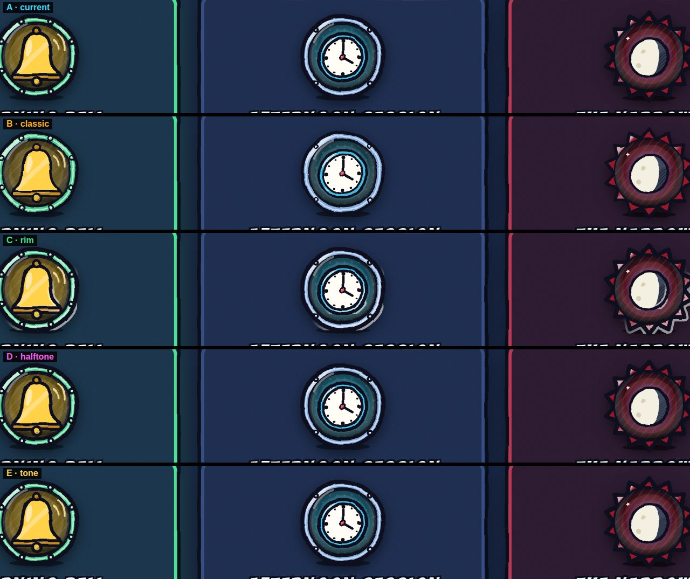
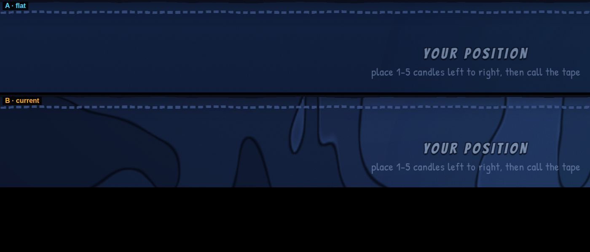
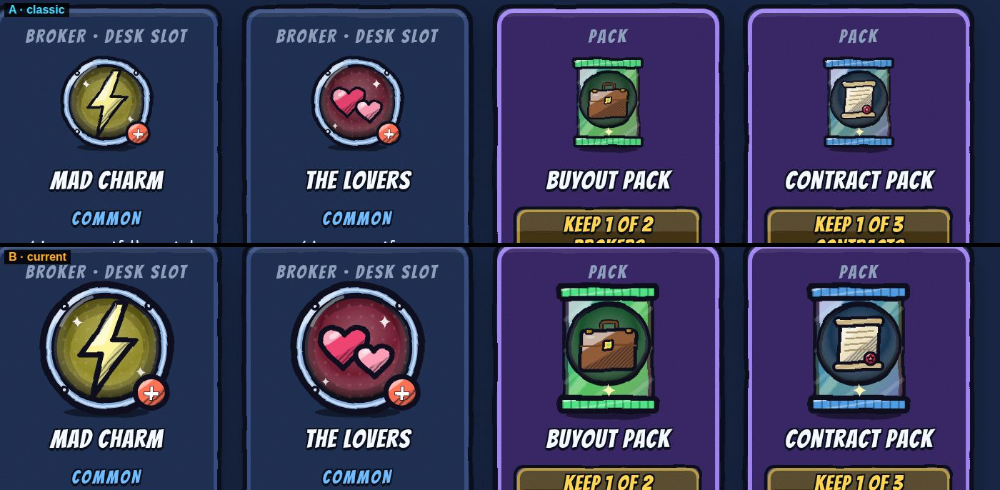
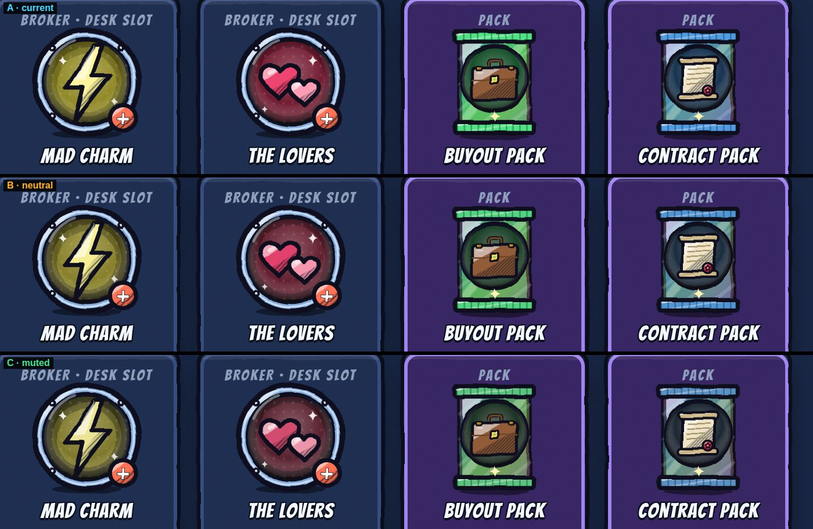
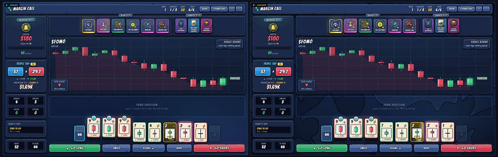
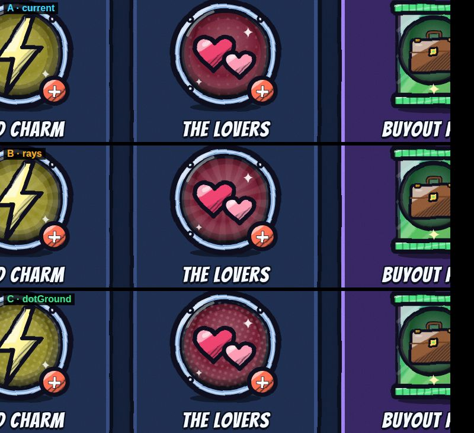

# The Art Lab: how the v1.12 look was chosen

Every change to the look in v1.12.0 won a head-to-head against what was there before. None of them
were picked by eye in isolation.

The game was drawn twice, side by side, in two **art styles**. Both copies were staged into exactly
the same moment (same seed, same desk, same placement), so the art was the only thing that
differed. Then the better of the two was picked. The tools are in the repo, and anyone can re-run a
round or judge it again:

- **`tools/artlab.html`** shows the real game twice in a browser. Pick a style for each side and a
  scene, then vote with `←` / `→`. Votes are kept on your device. Open it from a running game:
  `http://localhost:8080/tools/artlab.html`.
- **`tools/ab-capture.mjs`** does the same headless and saves a picture. It can produce a pair, a
  1:1 crop of the same region in two styles, or a `--grid` of any number of styles.
- **`src/ui/artstyle.js`** turns the look into knobs: ink weight, wobble, cel band, how shadows are
  shaded, palette shifts, and interface flags. `DEFAULT` holds the winners. Every candidate is
  still there as a named style, so `?artstyle=classic` on the game's address draws v1.11 again.

Each picture below has the shipping look labelled **current**. Every other label is one knob changed
from it.

## Round 1 — ink and shade

| Candidate | Verdict |
|---|---|
| **bold**: ink 1.5× instead of 1.12×, less wobble, a stronger cel band | **Won.** At the size a broker sits on the desk (about 46 px), the thin line went soft. The heavier one keeps the shapes readable and looks more like a printed card. |
| rim: a light line along the shadow edge | Lost. At card size it reads as a misprint, a ghost of the outline, not as light. |
| halftone: dots instead of hatching for shadow | Lost to hatching. It is only distinguishable up close, and the hatching is what makes the art look inked rather than printed. |
| tone: a flat dark shadow shape | Lost, narrowly. It is clean, but it is flat next to the hatching. |

## Round 2 — the room

**The marbled backdrop won** against the flat navy. It is a sheet of marbled endpaper: flat bands of
ink with a pen line wherever two meet, drifting slowly. It is drawn by a small WebGL shader at
reduced resolution, capped at 30 fps, and paused when the tab is hidden or motion is off. The
first version stepped into jagged pixels wherever the bands crowded together. That was fixed before
it was judged, because the brief says the art must never look pixelated.

The backdrop's cost was measured as well as its look. On software WebGL (a browser with hardware
acceleration off), animating it took the whole page from 31 fps to 9. So without a GPU it is now
drawn once and held still, and with one, a governor steps it down if the page's frame rate drops.

**Bigger pictures won** against the v1.11 size. The card art now fills the card: 60 px on the desk
(was 46), 100 px in the shop (was 70). On the old cards it sat small in a lot of empty frame.

## Round 3 — colour

**Punchier won** (saturation +12, lightness +3) against the palette as drawn (**neutral**) and a
desaturated, print-like version (**muted**). The muted version made the whole desk read as
disabled.

## The whole desk, before and after

## Round 4 — the ground behind a medallion

**The current fine texture stayed.** The sunburst (**rays**) looks good, but a sunburst is what
marks a Legendary broker, and putting one behind every medallion would blur that signal. The
halftone ground (**dotGround**) reads as noise at card size.
